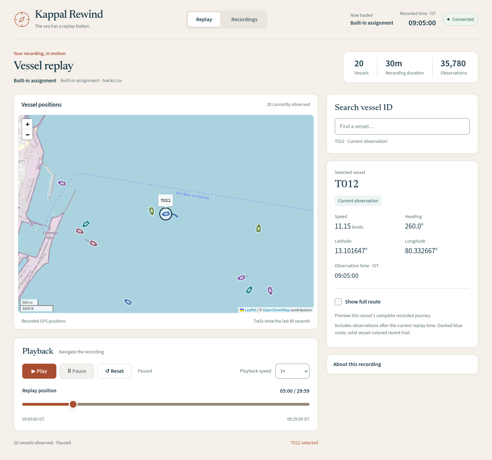
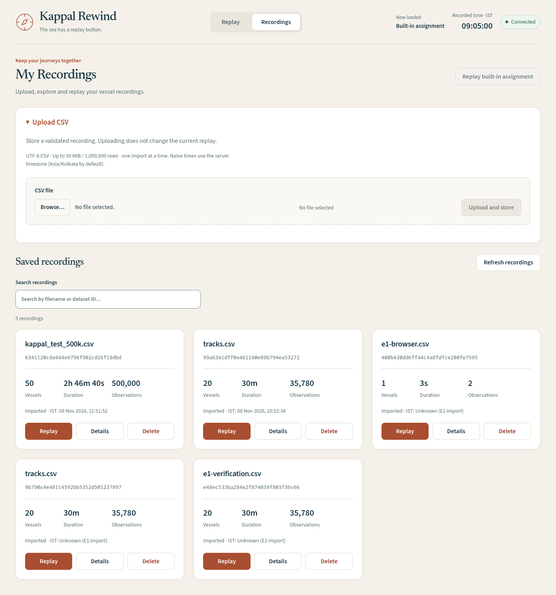

# Kappal Rewind
*The sea has a replay button.*

Kappal Rewind replays recorded vessel positions for the RSKD Labs full-stack assignment. It combines a server-controlled replay clock with a React map, vessel inspection and a persistent recording library. The supplied field export is validated and normalized without changing its original CSV bytes.

## Screenshots



Built-in recording at 09:05 IST, with T012 selected and actual 60-second trails.

## Features

- Leaflet replay with Play/Pause/Reset, timeline scrubbing and 1×/2×/5×/10× speeds.
- Heading-rotated ship markers, recent trails, searchable vessel selection and optional selected-vessel full-route inspection. Full routes include future recorded fixes; gaps remain disconnected.
- CSV schema/value validation, explicit timezone normalization and reported duplicate handling.
- Upload, browse, preview, select and safely delete recordings. Deleting the locally loaded recording leaves an empty workspace; other active clients block deletion.
- DuckDB/Parquet historical replay using bounded time windows, alongside the in-memory built-in recording.



Existing local recordings and the upload interface; a fresh installation starts with an empty uploaded library.

## Tech stack

**Frontend:** React, TypeScript, Vite, Leaflet. **Backend:** Python, FastAPI, WebSockets. **Storage:** in-memory built-in data; embedded DuckDB and Parquet uploads. **Deployment:** Docker Compose, Nginx. **Testing:** Pytest, Playwright.

## How to run

Requires Docker Engine, Docker Compose v2, free port 8080 and internet access for OpenStreetMap tiles. From a terminal:

```bash
git clone https://github.com/l0h1nth/Kappal-Rewind.git
cd Kappal-Rewind
docker compose up --build
```

Open [localhost:8080](http://localhost:8080). The built-in recording starts paused; each browser connection owns its replay session. Stop with Ctrl+C, then `docker compose down`; the named upload volume persists. Run one backend worker. This local assignment app has no authentication; do not expose it publicly without access controls. Upload behavior, limits and recovery: [recording guide](docs/DATASETS.md).

## Data problems found

- **35,820 source rows → 35,780 accepted observations.**
- Forty conflicting T007 duplicates resolved through whole-interval trajectory continuity: a documented heuristic, not proof of vessel identity.
- T012 has a 40-second gap; T015 a 180-second gap. No coordinates are invented or reassigned.
- Mixed naive/offset timestamps: naive times assume IST, with normalization to UTC.
- Eleven 360° headings become 0°; unsorted records are ordered chronologically.

Reproducible evidence and policy: [data audit](docs/DATA_AUDIT.md).

## Scaling to 500 vessels / 24 hours

At one observation per second, this means **43.2 million potential rows**. Current limits remain **50 MiB / 1,000,000 source rows**; 24-hour support is not implemented or tested. DuckDB filters Parquet time windows and reuses bounded forward replay overlap. I3's three-run synthetic benchmark measured 1M-row adjacent-frame construction at 91.81→25.83 ms; this is not a general throughput guarantee. Longer recordings need measured chunked ingestion/partitioning and concurrency budgets. Monitor process memory, query latency and WebSocket payload sizes; consider delta updates or rendering changes only when measurements justify them. Methods and limitations: [benchmarks](docs/BENCHMARKS.md).

## AI tools and web resources

Codex assisted implementation, refactoring, tests, verification and learning notes; independent AI agents reviewed data, replay and release readiness. Resources included official FastAPI, React/Vite, Leaflet, Docker and DuckDB/Parquet documentation; AIS Demo screenshots and upstream UI/design skills informed visual work. Praman documentation informed logging style. No independent human verification is claimed. Contributions and original resource links: [AI usage](docs/AI_USAGE.md).

[Data audit](docs/DATA_AUDIT.md) · [Benchmarks](docs/BENCHMARKS.md) · [Build log](docs/BUILD_LOG.md) · [AI usage](docs/AI_USAGE.md)
