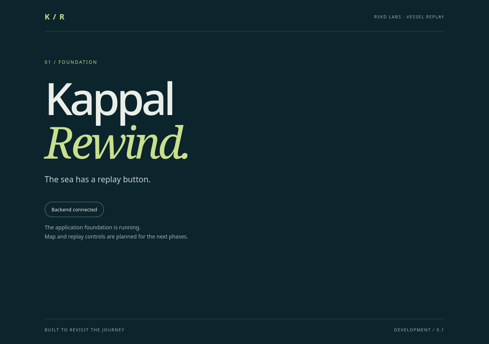

# Kappal Rewind
*The sea has a replay button.*

A vessel-track replay tool for the RSKD Labs internship assignment.
**Status: foundation only** — React page, FastAPI health endpoint and read-only
CSV audit. Map, data ingestion, WebSocket replay and playback controls are pending.
See the six-phase [implementation plan](PLAN.md).

**Stack:** React, TypeScript, Vite · Python, FastAPI · Nginx, Docker Compose · Pytest.
Leaflet/React Leaflet and WebSockets are planned; they are not installed/implemented yet.

## Run
Requires Docker Engine and Docker Compose v2; port 8080 must be free.
From this repository:
```sh
docker compose up
```
Open [localhost:8080](http://localhost:8080). The page should say “Backend connected”.
[Health endpoint](http://localhost:8080/api/health) returns `{"status":"ok"}` through
Nginx. Stop with Ctrl+C, then `docker compose down`. After source changes, rebuild
with `docker compose up --build`. The source CSV is mounted read-only.

For development/tests (Python 3.14, Node 24+, npm):
```sh
python3.14 -m venv .venv
.venv/bin/python -m pip install -r backend/requirements-dev.txt
. .venv/bin/activate
(cd backend && python -m pytest -q)
python3 scripts/audit_csv.py
(cd frontend && npm ci && npm run build)
```
Run `uvicorn app.main:app --reload` from `backend` with the venv activated, and
`npm run dev` from `frontend` for local development at :5173. Vite proxies `/api` to :8000.

## Data problems found
35,820 rows, 20 IDs, 1,800 seconds. Mixed offset-aware and naive timestamps
(audit assumes IST); 40 conflicting T007 keys; T012 lacks 40 seconds and T015
lacks 180 seconds; 11 headings equal 360°; source order has 60 backwards time
transitions. The original CSV is unchanged and checksum-verified. No cleanup is
implemented. Proposed handling and source evidence: [data audit](docs/DATA_AUDIT.md).

## For 500 vessels and 24 hours
At one observation per second that is 43.2 million rows. Replace full in-memory
loading with time-indexed storage and windowed reads, stream only requested
windows/deltas, and decimate older paths for display. Measure parsing, wire size
and browser rendering before adding workers or changing the rendering approach.

## AI and web resources
Codex generated this foundation and its tests/docs; independent AI reviewers check
critical work. Official FastAPI, Vite, Docker and Codex documentation informed setup;
Praman's documentation inspired concise append-only logs. Human verification has
not yet occurred. Contributions and actual checks: [AI usage](docs/AI_USAGE.md),
[build log](docs/BUILD_LOG.md), [learning notes](docs/LEARNING_NOTES.md).

The screenshot below is the running foundation, not the completed replay tool.

